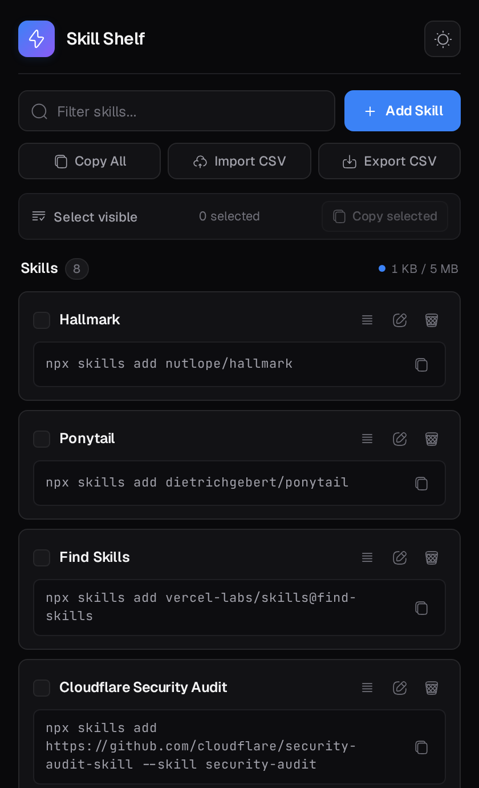
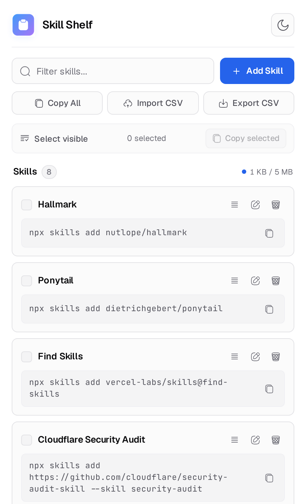
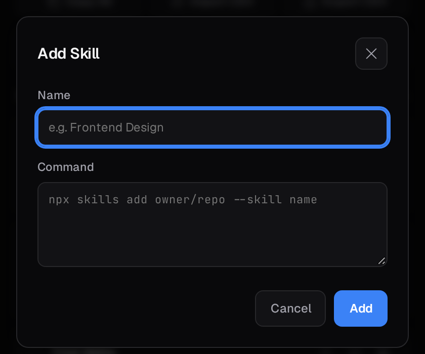
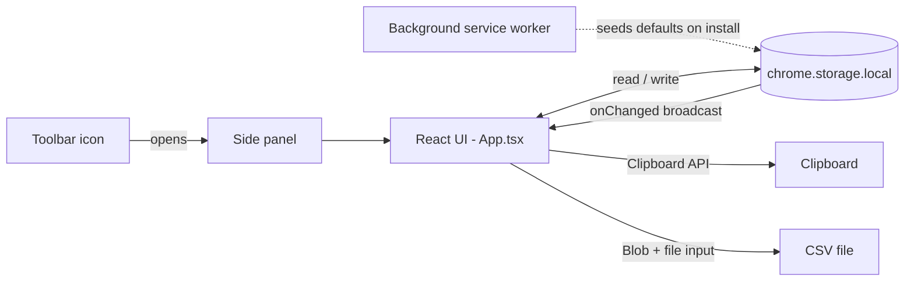

<div align="center">


<h1>Skill Shelf</h1>

<p><b>Every agent-skill command you keep re-typing — one click away.</b></p>

<p>A local-first Chrome side panel for collecting, reordering, and copying AI agent skill<br />
install commands and chained CLI stacks. No account, no server, no telemetry.</p>

<p>
  <a href="https://developer.chrome.com/docs/extensions/develop/migrate/what-is-mv3"></a>
  <a href="https://react.dev"></a>
  <a href="https://www.typescriptlang.org"></a>
  <a href="https://wxt.dev"></a>
  <a href="https://vite.dev"></a>
  <a href="#-permissions--privacy"></a>
  <a href="https://github.com/hetkumar5506/Skills-Shelf/stargazers"></a>
</p>

<p>
  <a href="#-features">Features</a> ·
  <a href="#-tech-stack">Tech Stack</a> ·
  <a href="#-architecture">Architecture</a> ·
  <a href="#-getting-started">Getting Started</a> ·
  <a href="#-usage">Usage</a> ·
  <a href="#-csv-backup--format">CSV Format</a> ·
  <a href="#-permissions--privacy">Privacy</a>
</p>

</div>

---

## 📸 Screenshots

| Dark | Light |
|:---:|:---:|
|  |  |

<p align="center">
  
  <br />
  <sub><b>Add / edit dialog</b> — autofocused, <code>Esc</code>-dismissible, with an inline command editor.</sub>
</p>

---

## Why Skill Shelf

Modern coding agents — Claude Code, Cursor, Copilot, Codex, Antigravity — are extended through **skills**, and a skill is usually just an install command: `npx skills add owner/repo`, a `shadcn` add, a `git clone` of a reference library, or a chained setup stack.

Those commands end up scattered across notes, DMs, and browser bookmarks. Skill Shelf keeps them in the browser **side panel** — visible while you work — so you can copy one command, or hand an agent the whole list as a ready-to-paste JSON array, without leaving the tab you're on.

---

## ✨ Features

### Capture & organize
- **Full CRUD** — add, rename, edit, and delete skills from a single dialog.
- **Drag-and-drop reordering** — drag any card by its handle; order is saved instantly.
- **Instant filter** — case-insensitive search across both the title and the raw command, with a one-click clear.
- **Command stacks** — chained commands (`&&`) are stored and copied verbatim, so multi-step setups survive intact.

### Copy that fits your workflow
- **One-click copy** — click any command box; the icon flips to a check and a toast confirms.
- **Copy All** — copies the entire shelf as a formatted JSON array, ready to prompt into any agent.
- **Copy Selected** — check individual cards (or **Select visible** to grab the current filter) and copy only those.
- **Clipboard fallback** — falls back to a hidden `textarea` + `execCommand` if the async Clipboard API is unavailable.

```json
[
  "npx skills add nutlope/hallmark",
  "npx skills add anthropics/skills --skill frontend-design"
]
```

### Backup & portability
- **CSV export** — UTF-8 with BOM and CRLF line endings, so Excel and Google Sheets open it cleanly.
- **Smart merge on import** — deduplicates against normalized command text; existing skills keep their titles and positions, only new items are appended.
- **Automatic titles** — an imported bare command gets a readable name derived from its `--skill` flag or its `owner/repo` path.
- **Guard rails** — clear inline errors for multi-column files, unclosed quotes, and empty imports.

### Comfort & craft
- **Dark & light themes**, persisted in `chrome.storage.local` and synced live across every open panel/browser window.
- **Storage meter** — live usage chip (`1 KB / 5 MB`) plus a **5 MiB guard** that blocks oversized writes with an inline warning.
- **Seeded on first run** — a fresh install starts with six curated skills; clearing storage intentionally leaves the shelf empty for a CSV restore.
- **Accessible by default** — `Esc` and backdrop dismissal, visible focus rings, labelled controls, `role="status"` toasts, and `prefers-reduced-motion` support.
- **Responsive layout** — tuned for side panels from 280 px up to 580 px, with a single-column card list that never overflows.

---

## 🧰 Tech Stack

| Layer | Technology | Version | Notes |
|:---|:---|:---|:---|
| UI library | **React** | 19.3 | Function components + hooks, rendered in `StrictMode` |
| Language | **TypeScript** | 5.7+ | `strict` + `noUncheckedIndexedAccess`, zero `any` in app code |
| Extension framework | **WXT** | 0.21 | Manifest generation, dev HMR, store-ready zips |
| Bundler | **Vite** | 8.3 | Powered by WXT's Vite integration |
| Extension APIs | **Chrome MV3** | — | `chrome.sidePanel`, `chrome.storage`, `chrome.action` |
| Styling | **Hand-written CSS** | — | shadcn-inspired token system, no CSS framework or runtime |
| Typography | **Geist** / **JetBrains Mono** | — | Google Fonts (UI text / command text) |
| Icons | **Reicon React** | 1.2 | Every glyph in the interface |
| State & persistence | **React hooks + `chrome.storage.local`** | — | Storage is the source of truth; React mirrors it |
| CSV engine | **Custom parser/writer** | — | RFC-4180-style quoting, zero dependencies |
| Linting | **`tsc --noEmit`** | — | Type check gate used before builds (`npm run typecheck`) |

**Footprint:** ~299 kB unpacked / **~105 kB zipped**, with only `react`, `react-dom`, and `reicon-react` shipped at runtime.

---

## 🏗 Architecture



- **`background.ts`** — a minimal MV3 service worker. It seeds `DEFAULT_SKILLS` once on a genuine install and calls `chrome.sidePanel.setPanelBehavior({ openPanelOnActionClick: true })`, so the toolbar icon opens the shelf directly.
- **`App.tsx`** — the whole product surface: search, selection, CRUD, drag-and-drop, CSV import/export, clipboard handling, theme, toasts, and the storage guard. Every mutation goes through one `persistSkills()` path that enforces the 5 MiB cap before writing.
- **`lib/types.ts`** — the single contract: `SkillItem`, `Theme`, storage keys (`skillshelf:skills`, `skillshelf:theme`), the storage limit, and the default seed list.
- **Sync model** — the panel subscribes to `chrome.storage.onChanged`; a theme toggle or edit in one window updates every other open panel in real time.
- **No content scripts, no host permissions, no remote code** — the extension never reads the page you're browsing.

---

## 📁 Project Structure

```text
Skills-Shelf/
├── entrypoints/
│   ├── background.ts            # MV3 service worker — seeding + side-panel behaviour
│   └── sidepanel/
│       ├── index.html           # Panel shell, fonts, color-scheme hints
│       ├── main.tsx             # React 19 root
│       ├── App.tsx              # UI, state, search, DnD, CSV, clipboard, theme
│       └── style.css            # Design tokens + component styles (dark & light)
├── lib/
│   └── types.ts                 # Types, storage keys, 5 MiB cap, default skills
├── public/
│   └── icon/                    # 16 · 32 · 48 · 128 px extension icons
├── docs/
│   └── screenshots/             # README previews
├── Agent-Skills.csv             # Curated, ready-to-import starter library
├── package.json                 # Scripts & dependencies
├── tsconfig.json                # Strict TypeScript configuration
├── wxt.config.ts                # Manifest V3: permissions, action, side panel, icons
└── README.md
```

---

## 🚀 Getting Started

### Prerequisites

| Requirement | Minimum |
|:---|:---|
| Node.js | 20+ |
| npm | 10+ |
| Browser | Chrome / Brave / Arc / Edge — anything Chromium-based with the **Side Panel API** |

### Run from source

```bash
# 1. Clone
git clone https://github.com/hetkumar5506/Skills-Shelf.git
cd Skills-Shelf

# 2. Install (postinstall runs `wxt prepare`)
npm install

# 3. Start dev mode — WXT launches Chrome with the extension + HMR
npm run dev
```

### Scripts

| Command | What it does | Output |
|:---|:---|:---|
| `npm run dev` | WXT dev server with hot reload; launches a browser profile with the extension loaded | `.output/chrome-mv3-dev/` |
| `npm run build` | Production MV3 build | `.output/chrome-mv3/` |
| `npm run zip` | Store-ready archive of the production build | `.output/skill-shelf-extension-1.0.0-chrome.zip` |
| `npm run typecheck` | Strict TypeScript check, no emit | — |
| `npm run postinstall` | Generates WXT types (runs automatically after install) | `.wxt/` |

---

## 🧩 Load into Chrome

1. Run `npm install && npm run build`.
2. Open `chrome://extensions`.
3. Turn on **Developer mode** (top-right).
4. Click **Load unpacked** and select the `.output/chrome-mv3` folder.
5. Pin **Skill Shelf** to the toolbar and click the icon — the shelf opens in the browser's side panel.

> Prefer a packaged build? `npm run zip` produces the archive, or load the dev folder from `npm run dev` directly.

---

## 🖱 Usage

| Action | How |
|:---|:---|
| **Add a skill** | **Add Skill** → name + command → **Add** |
| **Edit / delete** | Pencil / trash icon on the card |
| **Copy one command** | Click the command box (check icon + toast confirm) |
| **Copy everything** | **Copy All** → JSON array on your clipboard |
| **Copy a subset** | Tick cards, or **Select visible** to grab the filtered set → **Copy selected** |
| **Reorder** | Drag a card by the handle; drop above/below another card |
| **Filter** | Type in the search box; matches title **and** command |
| **Change theme** | Sun/moon button in the header — synced across windows |
| **Back up / restore** | **Export CSV** / **Import CSV** |

**Dialog behaviour:** `Esc` or a backdrop click closes it; the name field autofocuses; names are capped at 80 characters and commands at 20,000.

---

## 📄 CSV Backup & Format

Skill Shelf exports a **single-column CSV** with the header `Skill`. Each row is `Name :: command`:

```csv
Skill
Hallmark :: npx skills add nutlope/hallmark
Ponytail :: npx skills add dietrichgebert/ponytail
Find Skills :: npx skills add vercel-labs/skills@find-skills
Cloudflare Security Audit :: npx skills add https://github.com/cloudflare/security-audit-skill --skill security-audit
React Bits :: npx shadcn@latest add @react-bits/SplitText-TS-TW && npx jsrepo@latest add https://reactbits.dev/r/SplitText-TS-TW
Spec Kit :: uv tool install specify-cli && specify init my-project --integration copilot && cd my-project
Arena Skill :: npx skills add jakeschincariol/arena-skill
Anatomy :: npx skills add wheresryan22/anatomy -g
Skillry :: npx skills add skillry
Public APIs :: git clone https://github.com/public-apis/public-apis.git
shadcn/ui :: npx skills add shadcn/ui
Repomix Explorer :: npx skills add yamadashy/repomix --skill repomix-explorer
```

*A curated, ready-to-import starter library is included in [`Agent-Skills.csv`](Agent-Skills.csv).*

### Format rules

- **Header detection** — a first row of `Skill`, `Skills`, `Command`, or `Skill Command` is skipped automatically; a file without a header imports fine.
- **Quoting** — cells are exported with RFC-4180 quoting, so commas, quotes, and `&&` chains survive a round trip. Utilities like Excel are safe to use.
- **One column only** — extra columns raise a clear error instead of silently mangling commands.
- **Title inference** — a bare command (no ` :: `) gets a title from its `--skill` value, then its `owner/repo` path, then a trimmed snippet of the command.

### Merge logic on import

| Case | Behaviour |
|:---|:---|
| Command already on the shelf | Skipped — existing title and position untouched |
| Duplicate rows inside the same file | Collapsed to one |
| New command | Appended to the bottom, in CSV order |
| Nothing new | Toast reports how many duplicates were skipped |

Deduplication compares **normalized command text** (trimmed, whitespace collapsed), not titles — so renaming a skill never re-imports it.

---

## 🗄 Data Model

Everything is stored locally under two keys:

| Key | Type | Description |
|:---|:---|:---|
| `skillshelf:skills` | `SkillItem[]` | Ordered shelf. `{ id, name, command }` where `id` is a UUID |
| `skillshelf:theme` | `'dark' \| 'light'` | UI theme; defaults to dark |

```json
[
  {
    "id": "1c9f0c1e-1f0e-4c66-9d07-2f6f1f5b7d9e",
    "name": "Frontend Design",
    "command": "npx skills add anthropics/skills --skill frontend-design"
  }
]
```

- **Text only** — no files, blobs, or page data are ever stored.
- **5 MiB application cap** — writes larger than that are rejected with an inline warning before they touch storage.
- **Fresh install** seeds six curated skills; if you clear extension storage later, the panel stays empty so a CSV can restore exactly what you want.

---

## 🔒 Permissions & Privacy

| Permission | Why it's required |
|:---|:---|
| `storage` | Persist your shelf and theme in `chrome.storage.local` |
| `sidePanel` | Render the UI in Chrome's native side panel and open it from the toolbar icon |
| `clipboardWrite` | One-click copy of commands and JSON arrays |

**Not requested:** host permissions, `tabs`, `scripting`, content scripts, or web-accessible resources. The extension cannot see or modify the pages you browse.

- **No accounts, no sync server, no analytics, no tracking.**
- **No remote code** — everything is bundled at build time and subject to the MV3 content security policy.
- **One outbound request:** the side panel loads the Geist / JetBrains Mono stylesheet from Google Fonts. That's the only network call the UI makes; if you need a fully offline build, self-host those fonts and drop the `<link>` in `entrypoints/sidepanel/index.html`.

---

## 🎨 Design System

The UI is a small, deliberate token system rather than a component library.

| Token | Dark | Light |
|:---|:---|:---|
| Background | `#09090b` | `#ffffff` |
| Surface | `#121215` | `#fbfbfb` |
| Border | `#27272a` | `#e4e4e7` |
| Text | `#f4f4f5` | `#09090b` |
| Muted text | `#a1a1aa` | `#52525b` |
| Accent | `#3b82f6` | `#2563eb` |
| Accent gradient | `#3b82f6 → #8b5cf6` | `#2563eb → #7c3aed` |
| Danger | `#ef4444` | `#dc2626` |

- **Type** — Geist at a 13 px base for the UI; JetBrains Mono at 11 px for command text, so `--flags` and paths stay legible.
- **Shape & motion** — 8 px radii for controls, 12 px for the dialog, 150 ms transitions, and a global `prefers-reduced-motion` opt-out.
- **Icons** — [Reicon React](https://www.npmjs.com/package/reicon-react) at 13–18 px for consistent optical weight.
- **Surfaces** — cards lift on hover, selected cards take an accent border and tint, and the drop target gets a 2 px accent edge.

---

## 🧭 Design Decisions

- **The browser side panel, not a new tab** — commands are needed *while* working, so the shelf sits beside the page instead of replacing it.
- **`chrome.storage.local` as the only source of truth** — no state library, no hydration bugs; React state is a mirror and `onChanged` handles multi-window sync.
- **CSV, not a cloud account** — a spreadsheet is the most portable, inspectable backup format, and it survives uninstalling the extension.
- **Dedupe by command, not name** — the command is the thing that actually installs a skill; titles are cosmetic and free to change.
- **A self-imposed 5 MiB cap** — a shelf is text, so the app fails loudly long before Chrome's storage quota does.

---

## 🤝 Contributing

Issues and pull requests are welcome.

```bash
git checkout -b feat/your-idea
npm install
npm run dev        # iterate with HMR
npm run typecheck  # must pass
npm run build      # must succeed
```

Guidelines: keep the dependency surface small, preserve the "no telemetry / no host permissions" promise, and match the existing token-based styling rather than adding a CSS framework.

---

## 📜 License

No license file is included yet. If you'd like others to use or contribute to this project, adding an [MIT license](https://choosealicense.com/licenses/mit/) is recommended.

<div align="center">
  <sub>Built with <a href="https://wxt.dev">WXT</a>, <a href="https://react.dev">React</a>, and an unreasonable number of copied commands.</sub>
</div>
